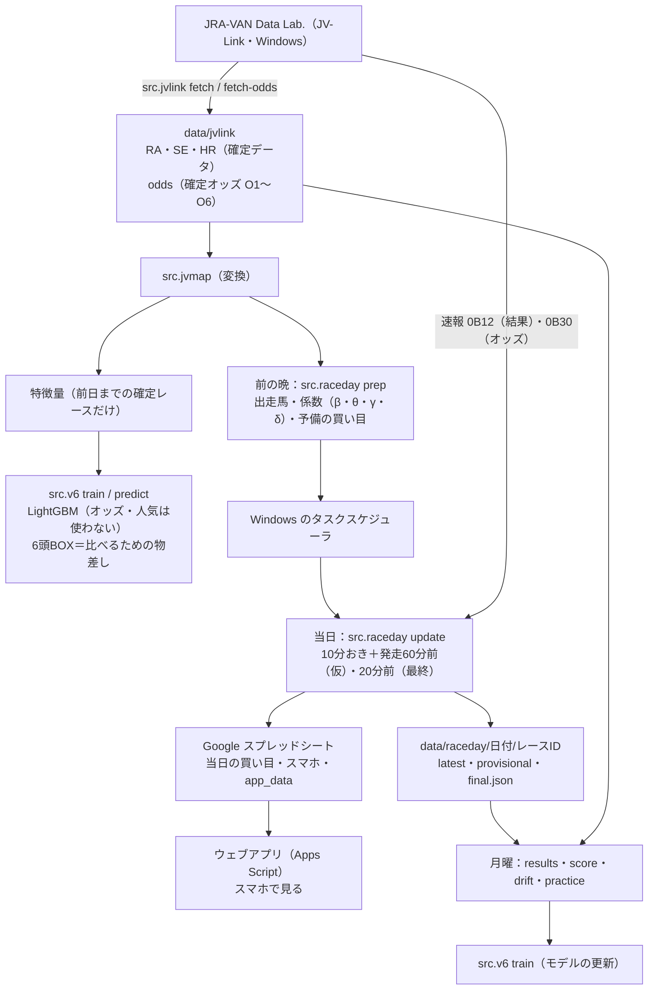

# 競馬AI：12,000円を5万円以上にする確率を最大にする

JRA の重賞で、**12,000円の予算で払戻 5万円以上になる確率（達成率）** を最大にするための仕組み。
本番は **2026年12月27日の有馬記念** の1レースだけ。

> 個人の研究・記録用のリポジトリです。馬券で利益が出ることを保証するものではありません（下の「注意書き」）。

---

## 1. 概要

### 目的：的中率でも回収率でもなく「達成率」

1レースの予算 12,000円に対して、払戻の合計が **5万円以上** になったら「熱い当たり」。その確率（達成率）を最大にする。

- 的中率を上げると、配当の小さい組ばかりになり 5万円に届かない
- 回収率（期待値）を軸にした案は、試した範囲ではうまくいかなかった（期待値フィルタは閾値を上げるほど回収率が悪化、
  モデルと市場の乖離で狙う案は的中率が 1/86 に。[docs/v1](docs/v1_kaggle_baseline.md)・[docs/v2](docs/v2_hot_hits.md)）
- 有馬記念で欲しいのは「当たったときに熱い」こと。回収率が 100% を下回っても、達成率が高い買い方を選ぶ

### 今の買い方 F（v9 の確認のテストで採用。[docs/v9_confirm.md](docs/v9_confirm.md)・[docs/v10_raceday.md](docs/v10_raceday.md)）

1. **勝つ確率**：単勝オッズから市場の勝率を出し、**当日の傾向（3b）** で傾ける。
   `P_i ∝ exp(β·log 市場_i + θ₁·当日_内枠×枠位置 + θ₂·当日_前残り×脚質)`（条件付きロジット）。
   当日の傾向は、同じ日・同じ競馬場・同じ芝ダで、対象レースの発走の **40分以上前** に発走し、その時点で結果が届いていたレースから作る。
   係数はレースの日より前の平場で推定（12月中旬に固定）
2. **3連単などの確率**：Henery 型（2着・3着の段を p^γ・p^δ で計算し直す。γ・δ も前の期間の平場で推定）
3. **買い目**：券種混合（馬連・馬単・3連複・3連単）、**15点まで**、合計 12,000円。
   1点ごとに「推定配当 × 金額 ≥ 5万円 × k」（今は **k = 1.4**）。推定配当は市場の確率と払戻率から
4. **付け替え**：最終の買い目を作るとき（今は発走 **20分前**）に本物の速報オッズで見て、5万円 × m（今は **m = 1.00**）に届かない買い目へ、
   余裕のある買い目から 100円ずつ回す（合計・点数は変えない）

k・m・最終の時刻は 12月中旬に決める（下の「4. 検証のやり方」）。

### お金を賭けるのは有馬記念だけ

それまでの毎週末の重賞は、有馬記念と同じ仕組みを自動で動かす**記録のための練習**（お金は賭けない）。
今のモデルの6頭BOX（v6）も比べるための物差しとして記録を続けている。

---

## 2. 仕組みの全体図



- **データの取り込み**：`py -m src.jvlink fetch`（確定データ・出馬表）、`fetch-odds`（確定オッズ）。生データは `data/`（コミットしない）
- **特徴量とモデル**：v6 の LightGBM（学習 2003年〜、ラウンド数 454）。上位6頭の3連単BOX を毎週記録し、F と比べる物差しにしている
- **前の晩**：`py -m src.raceday prep --date <翌日> --schedule` が、出走馬・係数・予備の買い目を保存し、タスクスケジューラに当日の実行を登録する
- **当日**：`update` が 9:00 から 10分おき＋各重賞の発走60分前・20分前ちょうどに動く。速報の結果（0B12）→ 当日の傾向 → F の買い目 →
  速報オッズ（0B30）で付け替え → JSON に保存 → シートと `app_data` に書く。60分前以降の最初の回が**仮**、20分前以降の最初の回が**最終**（以後は更新しない）
- **スマホで見る**：シートのタブ「スマホ」、または `app_data` を読むウェブアプリ（Google Apps Script。[docs/v17_webapp.md](docs/v17_webapp.md)）
- **月曜の答え合わせ**：`results`（6頭BOX）・`score`（F の最終の買い目）・`drift`（20分前と確定のオッズのずれ）・`practice`（全レースの練習）→ `train`

---

## 3. 動かし方

### 必要なもの

| もの | 内容 |
|---|---|
| Windows | JV-Link（COM）が Windows 専用。コマンドは `py` で呼ぶ |
| Python | 3.11 で開発・テストしている（それ以外の版は未確認）。`py -m pip install -r requirements.txt`（pandas 3 系で動かしている） |
| JRA-VAN Data Lab. | 契約・利用キーの登録・JV-Link のインストール。SDK は環境変数 `JVSDK_DIR` の場所から読む（リポジトリには入れない） |
| Google | サービスアカウントの鍵（JSON）と、そのアカウントに編集を許したスプレッドシート |

```powershell
git clone <このリポジトリの URL>
cd <クローンしたフォルダ>
py -m pip install -r requirements.txt
$env:JVSDK_DIR = "C:\path\to\JRA-VAN Data Lab. SDK"
py -m pytest -q
```

### `local_settings.json`（リポジトリ直下。`.gitignore` 済み）

値はすべて置き換え用の仮のもの。環境変数 `KEIBA_GOOGLE_KEY`・`KEIBA_SHEET_ID` でも渡せる。

```json
{
  "google_service_account_file": "C:\\path\\to\\secrets\\google_service_account.json",
  "spreadsheet_id": "YOUR_SPREADSHEET_ID",
  "entry_sheet": "評価入力",
  "record_sheet": "記録"
}
```

### 毎週の手順

| いつ | すること | 時間の目安 |
|---|---|---|
| 開催の前夜（金曜・土曜。月曜開催なら日曜も） | `py -m src.jvlink fetch --option 1` → `py -m src.raceday prep --date <翌日> --schedule`（6頭BOX の予想の記録と予備の買い目も、この中で） | 15〜25分 |
| 当日 | **何もしなくてよい**。PC は下の条件で。スマホでウェブアプリかシートの「スマホ」を見る | — |
| 開催の翌日（月曜。3日間開催なら火曜） | `fetch --option 1` → `py -m src.jvlink fetch-odds` → `py -m src.v6 results --sheet` → `py -m src.raceday score --sheet` → `py -m src.raceday drift` → `py -m src.raceday practice --date <開催日>,… --sheet` → `py -m src.v6 train` | 合わせて 30分〜1時間ほど（目安。全体の時間は未計測） |
| 平日（必要なとき） | ドライラン `py -m src.raceday replay --date …`、調査 `practice --explain`、試算 `py -m src.v9 rebalance …` | コマンドごと（[docs/commands.md](docs/commands.md)） |
| 12月中旬（1回だけ） | 最終の時刻・k・m を決めて固定（下の「4.」） | — |

細かい手順・期待される出力は [docs/v10_raceday.md](docs/v10_raceday.md)、週ごとの変更はその各節にある。

### 当日の PC の条件

- Windows に**ログオンしたまま**（タスクは「ログオンしているときだけ」動く設定。管理者権限は要らない）
- **電源ケーブル**をつなぐ。電源とスリープ →「スリープしない」。**ふたを閉じても眠らない**電源の設定にする
  （実行中と待機中のスリープは `keepawake` で防ぐが、ふたを閉じたときのスリープは防げない）
- **Windows Update** を一時停止するか、アクティブ時間に 9〜17時を入れる
- 時刻を自動で合わせる・タイムゾーン (UTC+09:00)。**デュアルブート**で時計が9時間ずれるときは、Ubuntu 側で
  `timedatectl set-local-rtc 1 --adjust-system-clock`（または Windows 側で RealTimeIsUniversal。どちらか一方）
- ネットが切れた・PC が止まっていたときは、シートとウェブアプリに「最終更新から ○分」「止まっていた可能性」が出る（[docs/v10_raceday.md](docs/v10_raceday.md) の v14）

### スマホで見る

- ウェブアプリ（Google Apps Script。実行は自分・アクセスは自分のみ）の設定手順：[docs/v17_webapp.md](docs/v17_webapp.md)
- 予備：スプレッドシートのタブ「スマホ」（3列・最終を書いた枠はチェックを消さない）。詳しくは「当日の買い目」タブ

### 主なコマンド

一覧と説明は [docs/commands.md](docs/commands.md)。よく使うもの：

| コマンド | 何をする |
|---|---|
| `py -m src.jvlink fetch --option 1` | 確定データ・出馬表の差分を取り込む |
| `py -m src.jvlink fetch-odds` | 確定オッズ（O1〜O6）を保存（月曜） |
| `py -m src.v6 train` / `predict --date … --sheet` / `results --sheet` | 今のモデル（6頭BOX）の学習・予測・照合 |
| `py -m src.raceday prep --date … --schedule` | 前の晩の準備とタスクの登録 |
| `py -m src.raceday update` | 当日の1回分（タスクスケジューラが呼ぶ） |
| `py -m src.raceday score --sheet` | F の最終の買い目の答え合わせ（6頭BOX と並べる） |
| `py -m src.raceday drift` | 20分前（と10分前）のオッズと確定オッズのずれ |
| `py -m src.raceday practice --date … [--sheet / --explain / --at 10]` | 全レースの練習の記録・調査・最終の時刻の比べ |
| `py -m src.raceday sheet --date …` / `app-preview` | シートの書き直し / ウェブアプリの画面を PC で見る |
| `py -m src.v9 confirm` / `rebalance` / `rebalance-decide` | 重賞での確認のテスト / 付け替えの試算 / k・m の決定 |
| `py -m src.raceday decide-final` / `freeze` | 最終の時刻の決定 / 係数・k・m・最終の時刻の固定 |

---

## 4. 検証のやり方（このプロジェクトで一番大事にしていること）

### 時系列の分け方

5つの fold で、**過去で学習して未来で確かめる**（`src/validate.py` の `V5_FOLDS`）。

| fold | 学習 | 確かめる |
|---|---|---|
| 1 | 2003〜2010 | 2011〜2013 |
| 2 | 2003〜2013 | 2014〜2016 |
| 3 | 2003〜2016 | 2017〜2019 |
| 4 | 2003〜2019 | 2020〜2022 |
| 5 | 2003〜2022 | 2023〜2026 |

市場の傾き（β・θ）や γ・δ は、その fold より**前の fold の平場**で推定する（fold 1 は推定にだけ使い、比べるのは fold 2〜5）。

### 先の情報が混ざらないための工夫

- 過去成績は「自分より前の行だけ」から作る道具（`src/leakfree.py`）で作る。未来や自分のレースの結果を書き換えても特徴量が変わらないことをテストで確かめている
- 特徴量は **as_of="day"**：前日までに確定したレースだけで作る（同じ日の先のレースも使わない。学習も予測も）
- **学習の経路と予測の経路の一致**：過去のレースを両方の経路で作り、馬体重以外の全列が一致することを確かめる（[docs/v6_predict.md](docs/v6_predict.md)）
- ラウンド数は 454 に固定（検証期間で early stopping しない）。出馬表の時点で無い馬体重は代用（前走・増減0）＝本番と同じ
- 当日の傾向は、対象レースの発走の 40分以上前に発走し、その時点で結果が届いていたレースだけ。係数は**レースの日より前**のデータで推定
- 本番で使えない情報（オッズ・人気・JRA-VAN のマイニング予想）はモデルの特徴量に入れない。市場の情報は F の中で「市場の確率」として明示的に使う

### 平場で試し、重賞では事前に決めたルールで1回だけ確かめる

- 新しい案はまず**平場だけ**で比べる。新しい案の成績を計算する関数は重賞の行が混ざると止まる（`experiment.exploration_only()`）
- **試した案の数を数えている**（多重比較で偶然の当たりを拾わないため）。v8 のフェーズの合計は 70（[docs/v8_validation.md](docs/v8_validation.md)）
- 重賞では、案と判定のルールを先に固定して**1回だけ**確かめる（`py -m src.v9 confirm`。やり直しには理由が要り、実行ごとに記録が残る）
- 達成率は Wilson 区間、同じレース同士の比較は対応のある差の区間（Newcombe）と McNemar の p 値で判定する

### 主な結果

- **重賞での確認のテスト（v9）**：重賞 1,643 レース（fold 2〜5、2026-10-25 まで）で、
  **F 11.14% 対 今のモデルの6頭BOX 5.23%（差 +5.90%、97.5% 区間 [3.75%, 8.09%]）** → F を採用。
  数値の出どころは `py -m src.v9 confirm` の実行結果（`data\v9\confirm_*`。データなのでリポジトリには入れていない）。判定のルールは [docs/v9_confirm.md](docs/v9_confirm.md)
- **付け替えの試算（`py -m src.v9 rebalance`）**：`practice` が検証の参考として並べる値は、F が平場 11.91%・重賞 11.14%、
  「付け替え・ずれあり」が平場 12.57%・重賞 11.64%（[docs/v10_raceday.md](docs/v10_raceday.md) の v15）。
  この「付け替え・ずれあり」の条件（m・ずれの分布）は docs に明記がなく未確認。実データのずれでの試算はまだ1回も回していない（12月中旬の決定で回す）
- 練習（全レース・本番と同じ形）の平場 91 レース（11/7・8・14・15）：熱い当たり 6.6%、予測の達成確率の平均 12.8%、的中 12 のうち 6 が 5万円に届かず（依頼書 v19 に記載の実行結果）。調査中（下の「5.」）

### 12月中旬に決めること（結果を見る前に決めたルール）

| 決めること | コマンド | ルール |
|---|---|---|
| 最終の買い目を作る時刻（20分前か10分前か） | `py -m src.raceday decide-final` | 重賞・10〜300倍・4券種まとめ・同じ組で「確定でも届く割合」が10分前のほうが高く、**かつ**平場の練習（`practice --at 10`）で10分前の熱い当たりの割合が20分前を下回らないときだけ10分前。それ以外は20分前 |
| 最初の金額の余裕 k・付け替えの目標 m | `py -m src.v9 rebalance-decide` | 平場で試算（ずれは重賞のサンプルから。足りない組は平場・仮の分布）。熱い当たりの割合が一番高い (k*, m*) と k = 1.4 の中の m₁.₄ を選ぶ。k* < 1.4 なら重賞で1回だけ比べる |
| 固定 | `py -m src.raceday freeze --k … --m … --final-minutes …` | 係数・k・m・最終の時刻を固定し、有馬記念の prep で使う |

順番は `drift` → `practice --at 10` → `decide-final` → `rebalance-decide` → `freeze`（最終を10分前に決めたら、k・m は10分前 → 確定 のずれで試算する）。
どちらの決定も1回だけ（やり直しには実装のバグの説明が要る）。詳しくは [docs/v10_raceday.md](docs/v10_raceday.md) の v13・v18・v19。

---

## 5. 分かったこと・うまくいかなかったこと

- **1着の予測の精度を上げても、熱い当たりは増えなかった**。市場（単勝オッズ）がすでに知っている情報は上乗せにならない。
  例：「市場＋3b＋伸び」は 1着の log-loss が良くなったのに、熱い当たりは減った（[docs/v8_validation.md](docs/v8_validation.md) の v8d-2・v8e）。
  今のモデルの6頭BOX（市場を使わない）は確認のテストで F の半分以下だった
- **確率と配当の出どころが違うと、勝者の呪いが起きる**。自分の確率では高く、市場では低く見える組ほど選ばれやすく、その組の配当は推定より低いことが多い。
  F は確率を市場から作り（3b の小さな傾きを足すだけ）、推定配当も同じ市場から出している。点数の少ない買い目の確認は `py -m src.v9 curse`（結果の数値は docs に記録していない：未確認）
- **当日の傾向（3b）だけが、市場に織り込まれていない情報として採用された**。3c（開催の傾向）・レーティング・伸び・2・3着への来やすさなどは、
  事前に決めた採用のルールを満たさなかった（F は「市場＋3b」のまま。各案の数値は [docs/v8_validation.md](docs/v8_validation.md)）
- **達成率には天井がある**。払戻の期待値は「予算 × 払戻率」で、市場の確率が正しければどう買っても変わらない。
  払戻は 0 以上なので、マルコフの不等式から P(払戻 ≥ 5万円) ≤ 12,000 × 払戻率 ÷ 50,000（払戻率 77.5% でも約 18.6%）。
  予算・払戻率・目標額で上限が決まり、買い方で動かせるのはその範囲の中だけ（この上限は簡単な計算で、市場の確率が正しいという仮定つき）
- **当日の運用で起きた問題と対策**（[docs/v10_raceday.md](docs/v10_raceday.md)）
  - 速報（0B12）の CSV の形がふだんの取り込みと違い（`_seq` の列が無い）、当日の傾向が使えず市場だけになっていた（v10b）
  - シートで組番が日付に化けた（「3-8-2」など）。文字として書くようにし、馬単・3連単は「→」で書く（v10c）
  - `log.csv` の列がずれていた（v11）
  - PC のスリープ明けに JV-Link が戻らず2時間止まった。時間の上限・同じエラーでの打ち切り・実行中のスリープ防止・「最終更新から ○分」の表示（v14）
  - シートのタイムゾーンが東京でなく「最終更新から -540 分」になった（v15）
- **本番の形（20分前のオッズで金額を決める）では、検証（確定オッズで金額を決める）より「当たったのに5万円に届かない」が多い**。
  付け替えは20分前のオッズで「ちょうど5万円に届く金額」にするので、当たる組のオッズが締切までに下がると届かない、という見立て（未確認）。
  `py -m src.raceday practice --explain` で、オッズのずれかバグかを切り分けている（v19）。最終を10分前にする確認もこのため

---

## 6. 注意書き

- **JRA-VAN のデータ・SDK・学習したモデル・Google の鍵ファイル・シート ID・ウェブアプリの URL は、このリポジトリに含めていない**
  （`data/`・`local_settings.json`・`secrets/`・`*service_account*.json`・SDK のファイルは `.gitignore` 済み。
  SDK のファイルが紛れ込んでいないことはテスト `test_sdk_files_are_not_in_repository` が毎回確かめる）。
  JRA-VAN のデータの利用は JRA-VAN の規約に従うこと（再配布はしない）
- **馬券で利益が出ることを保証するものではない。** 検証の達成率も、熱い当たりは 10回に1回前後という意味で、ほとんどのレースでは5万円に届かない。
  馬券の購入は 20歳以上で、無理のない範囲で
- **テスト**：`py -m pytest -q`。今の件数は **418 passed, 7 skipped**（JRA-VAN の SDK が無い環境。SDK のある Windows での件数は未確認）

---

## 開発記録（docs）

| ファイル | 内容 |
|---|---|
| [docs/commands.md](docs/commands.md) | コマンドの一覧 |
| [docs/v1_kaggle_baseline.md](docs/v1_kaggle_baseline.md) | Kaggle データでの土台：リークのない特徴量、回収率評価 |
| [docs/v2_hot_hits.md](docs/v2_hot_hits.md) | 目的を達成率に変更。脚質・ペース、3連単の検証 |
| [docs/v3_race_selection.md](docs/v3_race_selection.md) | レースの選別、グレード別、熱い基準の感度 |
| [docs/v4_reproducibility.md](docs/v4_reproducibility.md) | 時系列CVでの再検証（H1〜H4） |
| [docs/v5_jravan.md](docs/v5_jravan.md) | JRA-VAN からの取得・変換・再検証、Windows での手順 |
| [docs/v6_predict.md](docs/v6_predict.md) | 出馬表からの予測、学習と予測の経路の一致、練習モード |
| [docs/v7_weekly.md](docs/v7_weekly.md) | 毎週の手順（6頭BOX）、シート・照合のきまり、学習開始年 |
| [docs/v8_validation.md](docs/v8_validation.md) | 最後の改良の検証（平場で試す）。市場・3連単の確率・買い目・当日の傾向・レーティング・本物のオッズ |
| [docs/v8_raceday_design.md](docs/v8_raceday_design.md) | 有馬記念当日の自動運用の設計 |
| [docs/v9_confirm.md](docs/v9_confirm.md) | 重賞で1回だけの確認のテスト（F・F2・B）と判定のルール |
| [docs/v10_raceday.md](docs/v10_raceday.md) | 当日の仕組み（v10〜v19）：手順・付け替え・スリープ対策・練習の記録・ずれ・決め方 |
| [docs/v17_webapp.md](docs/v17_webapp.md) | スマホ用のウェブアプリ（Apps Script）の仕組みと設定の手順 |

初期（v1〜v4）は Kaggle のデータ（1986〜2021年7月）で、6頭BOX の戦略を探した。v5 で JRA-VAN のデータに移り、
v1〜v4 に調教師成績のリークがあったことが分かって直した（v4 の数字はリークを含む）。
